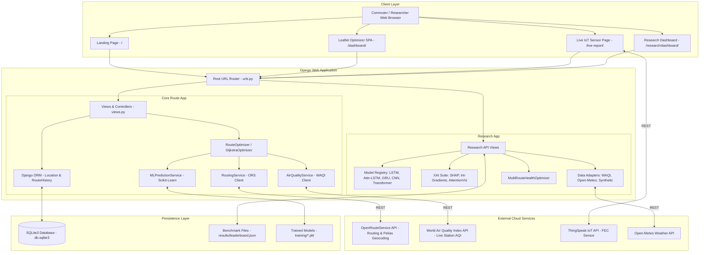

# Dhaka Air Route Optimizer & Spatiotemporal Research Platform

[](https://www.python.org/)
[](https://www.djangoproject.com/)
[](#running-automated-tests)
[](#docker-installation)
[](https://leafletjs.com/)
[](LICENSE)

An intelligent, health-aware geospatial routing and spatiotemporal air quality forecasting platform designed for Dhaka City.

Traditional navigation systems prioritize strictly shortest distance or lowest travel time, inadvertently guiding pedestrians, cyclists, and motorists through acute pollution hotspots and high-emission corridors. **Dhaka Air Route Optimizer** integrates real-time Air Quality Index (AQI) monitoring, multi-pollutant dispersion data, deep learning spatiotemporal forecasting, and detour optimization algorithms to deliver commuter routes that minimize toxic pollutant inhalation without excessive travel delays.

---

## Table of Contents

- [Overview](#overview)
- [Key Features](#key-features)
  - [1. Interactive Route Optimizer (Leaflet SPA)](#1-interactive-route-optimizer-leaflet-spa)
  - [2. Live IoT Air Quality Monitoring](#2-live-iot-air-quality-monitoring)
  - [3. Deep Learning & Spatiotemporal Research Platform](#3-deep-learning--spatiotemporal-research-platform)
  - [4. Reproducible Kaggle Research Notebooks](#4-reproducible-kaggle-research-notebooks)
- [System Architecture](#system-architecture)
- [Frontend Routes & Dashboard Pages](#frontend-routes--dashboard-pages)
- [Tech Stack](#tech-stack)
- [Repository Structure](#repository-structure)
- [Installation & Setup](#installation--setup)
  - [Prerequisites](#prerequisites)
  - [Option A: Local Development Setup](#option-a-local-development-setup)
  - [Option B: Docker & Docker Compose Setup](#option-b-docker--docker-compose-setup)
- [Configuration & Environment Variables](#configuration--environment-variables)
- [Running Automated Tests](#running-automated-tests)
- [API Reference](#api-reference)
  - [Core Routing APIs](#core-routing-apis)
  - [Research & Forecasting APIs](#research--forecasting-apis)
- [Kaggle Notebook Generation](#kaggle-notebook-generation)
- [Contributing & License](#contributing--license)

---

## Overview

Dhaka is frequently ranked among the most air-polluted metropolises globally, with Particulate Matter ($\text{PM}_{2.5}$ and $\text{PM}_{10}$) reaching hazardous levels during winter and dry seasons. Commuters face severe long-term cardiovascular and pulmonary health risks during daily travel.

This platform bridges the gap between environmental monitoring and daily navigation:
- **Real-Time Air Quality Exposure:** Samples live pollutant readings ($\text{PM}_{2.5}$, $\text{PM}_{10}$, $\text{NO}_2$, $\text{CO}$, $\text{O}_3$, $\text{SO}_2$) along candidate paths using the World Air Quality Index (WAQI) network.
- **Detour Optimization:** Calculates perpendicular lateral offsets and geographic bearings around high-pollution clusters to construct healthier alternate routes.
- **Health-Aware Exposure Modeling:** Quantifies particulate inhalation dosage ($\mu\text{g}$) and produces composite health scores tailored to individual vulnerability and transit modes (walking, cycling, driving).
- **Spatiotemporal AI Forecasting:** Employs sequence deep learning models (Attention-LSTM, Temporal CNN, Transformers, GRU, LSTM) with Explainable AI (SHAP & Integrated Gradients) to project air quality trends across 5 core Dhaka districts.

---

## Key Features

### 1. Interactive Route Optimizer (Leaflet SPA)
- **Map Interface:** Modern Leaflet.js map centered on Dhaka with OpenStreetMap tiles, dynamic waypoint popups, color-coded route polylines, and loading states.
- **Dhaka Geocoding & Autocomplete:** Real-time location search and coordinate translation powered by the OpenRouteService Pelias API.
- **8 Optimization Priorities:**
  - `balanced`: Joint optimization minimizing both travel distance and AQI exposure.
  - `cleanest`: Maximum air quality detour avoiding high pollution centroids.
  - `shortest`: Direct shortest-distance path.
  - `pm25`: Specialized minimization of fine particulate exposure ($\text{PM}_{2.5}$).
  - `pm10`: Minimization of coarse dust particles ($\text{PM}_{10}$).
  - `co`, `o3`, `so2`: Targeted gas pollutant exposure minimizations.
- **Side-by-Side Comparison Modal:** Evaluates Shortest, Balanced, and Cleanest paths concurrently with metrics for distance (km), duration (mins), and average AQI.
- **Pollutant Breakdown Cards:** Real-time concentration readings for all criteria pollutants at each sampled checkpoint.
- **Search History:** SQLite-backed record of previous routing queries for rapid retrieval.

### 2. Live IoT Air Quality Monitoring
- Dedicated dashboard (`/live-report/`) streaming live micro-sensor telemetry from ThingSpeak (FEC AQI sensor).
- Real-time monitoring of $\text{PM}_{1.0}$, $\text{PM}_{2.5}$, and $\text{PM}_{10}$ with dynamic Chart.js trend graphs, status badges, and 24-hour peak tracking.

### 3. Deep Learning & Spatiotemporal Research Platform
- **Model Registry (`/research/dashboard/`):** Unified benchmarking interface supporting 5 deep learning forecasting architectures:
  - **Attention-LSTM:** Captures long-range temporal dependencies with attention weighting.
  - **Standard LSTM:** Recurrent temporal sequence baseline.
  - **Gated Recurrent Unit (GRU):** Lightweight recurrent architecture.
  - **Temporal Convolutional Network (Temp-CNN):** 1D dilated convolutions for multi-scale temporal patterns.
  - **Lightweight Transformer:** Multi-head self-attention encoder for sequence forecasting.
- **Multi-Source Data Adapters:**
  - WAQI API Adapter for live observation feeds.
  - Open-Meteo Weather Adapter (temperature, relative humidity, wind speed, surface pressure).
  - 5-District Synthetic Spatiotemporal Generator (Dhanmondi, Gulshan, Mirpur, Motijheel, Uttara) simulating diurnal patterns, rush-hour spikes, and seasonal variations.
- **Explainable AI (XAI):**
  - **SHAP (SHapley Additive exPlanations):** Global and local feature attributions.
  - **Integrated Gradients:** Path-based gradient attributions across meteorological and chemical features.
  - **Temporal Attention Visualizer:** Visual weight attribution across preceding 24-hour input timesteps.
- **Automated Experiment Benchmarks:** Generates comparative evaluation tables and plots ($\text{RMSE}$, $\text{MAE}$, $\text{MAPE}$, $R^2$) saved to `results/leaderboard.json` and `results/leaderboard.csv`.

### 4. Reproducible Kaggle Research Notebooks
Six standalone, fully-executable Jupyter notebooks located in `kaggle_notebooks/`:
1. `01_dataset_analysis_and_eda.ipynb` — Comprehensive EDA, distribution analysis, and correlation matrices.
2. `02_feature_engineering.ipynb` — Lag features, rolling statistics, and meteorological normalization.
3. `03_ml_baselines.ipynb` — Evaluation of Linear Regression, Random Forest, Gradient Boosting, and SVR.
4. `04_dl_and_spatiotemporal.ipynb` — Training & evaluation of LSTM, GRU, Temp-CNN, and Transformer models.
5. `05_explainable_ai.ipynb` — Implementation of SHAP, Integrated Gradients, and Attention interpretability.
6. `06_health_routing.ipynb` — Health exposure dosage modeling and multi-route optimization algorithms.

---

## System Architecture



---

## Frontend Routes & Dashboard Pages

The platform features 4 distinct web interfaces catering to general commuters, environmental analysts, and machine learning researchers:

| Route URL | Page Name | Template | Primary Function |
|---|---|---|---|
| `/` | **Landing Home Page** | `landing.html` | Public introduction, Dhaka air crisis context, awareness, and portal navigation. |
| `/dashboard/` *(or `/index/`)* | **Interactive Route Optimizer Map** | `index.html` | Interactive Leaflet.js routing engine with 8 priority modes, live AQI sampling, and multi-route comparison. |
| `/live-report/` | **Live IoT Sensor Report** | `live_report.html` | Real-time physical sensor telemetry streaming $\text{PM}_{1.0}, \text{PM}_{2.5}, \text{PM}_{10}$ from a ThingSpeak FEC node. |
| `/research/dashboard/` | **Research & Deep Learning Platform** | `dashboard.html` | Multi-tab laboratory for spatiotemporal sequence forecasting, automated model benchmarking, Explainable AI (SHAP), and health inhalation dosage modeling. |
| `/admin/` | **Django Admin Console** | Built-in | Administration interface for `Location` entries, user authentication, and `RouteHistory` records. |

---

### Detailed Page Breakdown

#### 1. Landing Home Page (`/`)
- **Purpose:** Serves as the primary public entry point explaining why air-quality-aware routing matters in Dhaka.
- **Key UI Elements & Interactivity:**
  - **Navigation Bar:** Global top navigation with fast links to `Home`, `🔬 Research`, `📡 Live Report`, and `Launch Dashboard →`.
  - **Hero Call-to-Action:** Highlights key air quality metrics with an instant launcher button directly into the interactive map.
  - **Health Risk Visualizer:** Outlines exposure dangers across criteria pollutants ($\text{PM}_{2.5}$, $\text{PM}_{10}$, $\text{NO}_2$, $\text{CO}$).
  - **Algorithm Primer:** Explains the math behind perpendicular lateral detour offsets and geographic bearing calculations.

#### 2. Interactive Route Optimizer Dashboard (`/dashboard/`)
- **Purpose:** The core commuter-facing single-page application (SPA) for finding and comparing safe travel paths.
- **Key UI Elements & Interactivity:**
  - **Leaflet.js Map Canvas:** Responsive mapping viewport with custom map tiles, origin/destination pins, and sampled pollution checkpoints.
  - **Autocomplete Location Inputs:** Source and destination text fields with real-time Pelias geocoding suggestions scoped to Dhaka.
  - **Optimization Priority Selector:** Dropdown to calculate paths optimized for:
    - `Balanced (Distance + AQI)`
    - `Shortest Distance`
    - `Cleanest Air`
    - Specific pollutants (`Minimum PM2.5`, `PM10`, `CO`, `O3`, `SO2`)
  - **Route Metrics Panel:** Displays total distance (km), estimated duration (mins), average route AQI score, and color-coded health rating.
  - **Air Quality Breakdown Cards:** Station-calibrated concentrations for $\text{PM}_{2.5}$, $\text{PM}_{10}$, $\text{NO}_2$, $\text{CO}$, and $\text{O}_3$ along the route.
  - **Interactive Checkpoints Timeline:** Scrollable inspection of discrete points sampled along the path.
  - **Side-by-Side Comparison Modal (`Compare All Routes`):** Launches a comparative overlay evaluating Shortest, Balanced, and Cleanest routes side-by-side.
  - **Quick Header Navigation:** One-click pills to jump to `🏠 Home`, `🔬 Research`, or `📡 Live Report`.

#### 3. Live IoT Sensor Report (`/live-report/`)
- **Purpose:** Telemetry monitoring of real-time physical particulate matter sensors deployed in Dhaka.
- **Key UI Elements & Interactivity:**
  - **Real-Time Sensor Gauges:** Metric cards tracking live $\text{PM}_{1.0}$, $\text{PM}_{2.5}$, and $\text{PM}_{10}$ in $\mu\text{g/m}^3$.
  - **Dynamic Trend Graphs:** Chart.js time-series charts visualizing fluctuations over the previous hours.
  - **24-Hour Statistical Peaks:** Daily minimum, maximum, and average concentrations with health severity alerts.
  - **Sensor Status & Metadata:** ThingSpeak channel connectivity status, telemetry timestamp, and ping health.

#### 4. Research & Deep Learning Platform (`/research/dashboard/`)
- **Purpose:** An advanced spatiotemporal research dashboard designed for machine learning researchers and urban air quality analysts.
- **Organized into 4 Interactive Tabs:**
  - **📈 Tab 1 — AQI Forecast (`#tab-forecast`):**
    - Choose from 5 deep learning models: **Attention-LSTM**, **Standard LSTM**, **GRU**, **Temporal CNN**, or **Lightweight Transformer**.
    - Select target Dhaka district: **Dhanmondi**, **Gulshan**, **Mirpur**, **Motijheel**, or **Uttara**.
    - Configure forecast horizon (e.g. 24 hours) and generate projected pollution curves rendered with Chart.js.
  - **📊 Tab 2 — Automated Model Benchmarks (`#tab-comparison`):**
    - Comprehensive evaluation matrix measuring $\text{RMSE}$, $\text{MAE}$, $\text{MAPE}$, and $R^2$ scores across all models.
    - `🔄 Re-run Benchmark Suite` button to dynamically retrain/evaluate models and refresh the leaderboard.
    - Highlight banner recognizing the current leading architecture.
  - **🔍 Tab 3 — Explainable AI / XAI (`#tab-xai`):**
    - **SHAP Feature Importance:** Bar charts attributing predictions to PM2.5, PM10, temperature, humidity, and wind speed.
    - **Integrated Gradients:** Gradient-based step attribution explaining input feature influence.
    - **Temporal Attention Map:** Visual attention weights revealing which historical hours most heavily influenced the forecast.
  - **🏥 Tab 4 — Health-Aware Route Planner (`#tab-routing`):**
    - Computes 4 parallel route types: **Shortest**, **Fastest**, **Cleanest**, and **Best Health**.
    - Customizable commuter profile (age, respiratory vulnerability level, transit mode: walking, cycling, car).
    - Inhalation dosage computation: Calculates total inhaled particulate mass ($\mu\text{g}$) and composite safety scores.
  - **Header Actions:** Fast-switch navigation pills linking to `🏠 Home`, `🗺️ Map Dashboard`, and `📡 Live Report`.

---

## Tech Stack

| Domain | Technology / Library | Version | Purpose |
|---|---|---|---|
| **Backend Framework** | Django | 5.2.4 | Web server, REST API routing, ORM, and template rendering |
| **Language** | Python | 3.12 | Core programming environment |
| **Routing & Geocoding** | OpenRouteService | 2.3.3 | Isochrones, directions, distance matrix, and Pelias geocoding |
| **Geospatial Processing** | Geopy, Folium | 2.4.1 / 0.20.0 | Coordinate calculations, bearing, and geospatial mapping |
| **Air Quality Monitoring** | WAQI API / ThingSpeak | REST | Real-time AQI observation feeds and IoT sensor streams |
| **Data Science & ML** | NumPy, Pandas, SciPy | 2.3.1 / 2.3.1 / 1.16.0 | Array manipulation, time-series dataframes, scientific algorithms |
| **Machine Learning** | Scikit-Learn | 1.7.1 | Regression baselines, Scaler pipelines, and model evaluation |
| **Data Visualization** | Matplotlib, Seaborn | 3.10.5 / 0.13.2 | Static research plots, correlation heatmaps, leaderboard charts |
| **Interactive UI** | Leaflet.js, Chart.js | 1.9.4 / 4.4.3 | Interactive map viewports, routing layers, dynamic IoT trend charts |
| **Notebooks** | Jupyter & JupyterLab | 1.1.1 / 7.4.5 | Interactive reproducible research notebooks |
| **Containerization** | Docker & Docker Compose | 3.8 Spec | Isolated container execution and production-ready deployments |

---

## Repository Structure

```
Dhaka-Air-Route-Optimizer/
├── .env.example                        # Template for environment configuration
├── .gitignore                          # Git ignore specifications
├── Dockerfile                          # Multi-stage production container definition
├── docker-compose.yml                  # Docker Compose orchestration service
├── manage.py                           # Django CLI management entrypoint
├── requirements.txt                    # Project Python dependency manifest
├── README.md                           # Master project documentation
├── PROJECT_EXISTING_FEATURES.md        # Technical feature inventory & audit
├── INTEGRATION_TEST_REPORT.md          # Automated integration test report
├── AQI_9_Cities_renamed.csv            # Historical multi-city AQI dataset
├── generate_all_notebooks.py           # Automated runner to generate all 6 Kaggle notebooks
├── create_notebook_01.py ... 06.py     # Source generators for research notebooks
├── db.sqlite3                          # Local development database
│
├── dhaka_air_route/                    # Django project core configuration
│   ├── __init__.py
│   ├── asgi.py                         # ASGI entrypoint
│   ├── settings.py                     # Global Django settings, logging, and API keys
│   ├── urls.py                         # Root URL routing table
│   └── wsgi.py                         # WSGI production entrypoint
│
├── route_optimizer/                    # Primary application package
│   ├── admin.py                        # Django Admin interface configurations
│   ├── apps.py                         # App metadata configuration
│   ├── models.py                       # Location and RouteHistory ORM models
│   ├── urls.py                         # Application routing table
│   ├── views.py                        # HTTP request handlers & routing API endpoints
│   ├── tests.py                        # Application unit test suites
│   │
│   ├── services/                       # Business logic & external API wrappers
│   │   ├── air_quality_service.py      # WAQI API integration & weighted pollutant scoring
│   │   ├── dijkstra_optimizer.py       # Lateral detour optimization & waypoint routing
│   │   ├── routing_service.py          # OpenRouteService API wrapper
│   │   └── ml_prediction_service.py    # Offline-trained ML inference service
│   │
│   ├── research/                       # Research, Deep Learning & XAI module
│   │   ├── urls.py                     # Research dashboard & API routing
│   │   ├── views.py                    # Research API endpoints (predict, explain, routes)
│   │   ├── tests.py                    # Research module integration test suite
│   │   ├── data_adapters/              # WAQI, Open-Meteo & synthetic multi-district generators
│   │   ├── models/                     # Deep learning forecasters (Attention-LSTM, CNN, etc.)
│   │   ├── xai/                        # SHAP, Integrated Gradients, and Attention Visualizer
│   │   ├── routing/                    # Health exposure dosage & multi-route optimizer
│   │   └── experiments/                # Automated model benchmark & leaderboard evaluator
│   │
│   ├── static/                         # Static front-end assets
│   │   ├── css/style.css               # Main styling for optimizer & landing page
│   │   ├── css/research.css            # Styles for research dashboard
│   │   ├── js/map.js                   # Leaflet map initialization, routing, & AJAX
│   │   └── js/research_dashboard.js    # Research dashboard chart rendering & UI interaction
│   │
│   └── templates/                      # HTML5 templates
│       ├── route_optimizer/
│       │   ├── landing.html            # Public landing & feature introduction page
│       │   ├── index.html              # Main interactive route optimizer SPA
│       │   └── live_report.html        # Live IoT sensor monitoring dashboard
│       └── research/
│           └── dashboard.html          # Research & Deep Learning benchmark dashboard
│
├── kaggle_notebooks/                   # Pre-generated, reproducible research notebooks (01–06)
├── results/                            # Leaderboard metrics (CSV/JSON) & comparison plots
└── training/                           # Baseline model training notebook & pickle artifacts
```

---

## Installation & Setup

### Prerequisites
Before installing, ensure your environment has:
- **Python 3.10+** (Python 3.12 recommended)
- **Git** installed
- **Virtualenv** (`python3-venv`)
- External API keys (both free to acquire):
  1. **OpenRouteService API Key:** Sign up at [openrouteservice.org/dev](https://openrouteservice.org/dev/#/signup)
  2. **WAQI API Token:** Sign up at [aqicn.org/data-platform/token](https://aqicn.org/data-platform/token/)

---

### Option A: Local Development Setup

#### 1. Clone the Repository
```bash
git clone https://github.com/SafaruzzamanShovo/Dhaka-Air-Route-Optimizer.git
cd Dhaka-Air-Route-Optimizer
```

#### 2. Create and Activate a Virtual Environment
```bash
# On Linux / macOS:
python3 -m venv .venv
source .venv/bin/activate

# On Windows (Command Prompt / PowerShell):
python -m venv .venv
.venv\Scripts\activate
```

#### 3. Install Python Dependencies
```bash
pip install --upgrade pip
pip install -r requirements.txt
```

#### 4. Configure Environment Variables
Copy `.env.example` to create your local `.env` configuration:
```bash
cp .env.example .env
```
Edit `.env` and fill in your keys:
```env
SECRET_KEY=your-django-secret-key-here
DEBUG=True
ALLOWED_HOSTS=localhost,127.0.0.1
CSRF_TRUSTED_ORIGINS=http://localhost:8000,http://127.0.0.1:8000
ORS_API_KEY=your_openrouteservice_api_key_here
WAQI_API_KEY=your_waqi_api_token_here
```

#### 5. Apply Database Migrations
Initialize the SQLite database schema:
```bash
python manage.py migrate
```

#### 6. (Optional) Create an Admin Superuser
```bash
python manage.py createsuperuser
```

#### 7. Run the Development Server
```bash
python manage.py runserver
```

Open your browser and navigate to:
- **Landing Page:** [http://127.0.0.1:8000/](http://127.0.0.1:8000/)
- **Route Optimizer Dashboard:** [http://127.0.0.1:8000/dashboard/](http://127.0.0.1:8000/dashboard/)
- **Live IoT Sensor Report:** [http://127.0.0.1:8000/live-report/](http://127.0.0.1:8000/live-report/)
- **Research & Deep Learning Dashboard:** [http://127.0.0.1:8000/research/dashboard/](http://127.0.0.1:8000/research/dashboard/)
- **Django Admin Console:** [http://127.0.0.1:8000/admin/](http://127.0.0.1:8000/admin/)

---

### Option B: Docker & Docker Compose Setup

If you prefer to run the entire application inside an isolated Docker container:

#### 1. Configure the `.env` File
Ensure your `.env` file exists and is populated with your API keys:
```bash
cp .env.example .env
```

#### 2. Build and Launch Containers
```bash
docker compose up --build
```

#### 3. Access the Application
The service will be mapped to port `8000`:
- **Web App:** [http://localhost:8000/](http://localhost:8000/)
- **Research Dashboard:** [http://localhost:8000/research/dashboard/](http://localhost:8000/research/dashboard/)

To stop the container:
```bash
docker compose down
```

---

## Configuration & Environment Variables

All sensitive credentials and environment-specific settings are managed via `.env` using `python-decouple`:

| Variable | Description | Default / Example | Required |
|---|---|---|---|
| `SECRET_KEY` | Django unique secret key for cryptographic signing | `django-insecure-your-secret` | Yes (in prod) |
| `DEBUG` | Enable/disable Django debug mode | `True` for dev, `False` for prod | Yes |
| `ALLOWED_HOSTS` | Comma-delimited list of host/domain names | `localhost,127.0.0.1` | Yes |
| `CSRF_TRUSTED_ORIGINS` | Comma-delimited list of trusted origins for CSRF | `http://localhost:8000,http://127.0.0.1:8000` | Yes |
| `ORS_API_KEY` | OpenRouteService API key for routing & Pelias geocoding | Obtain from OpenRouteService | Yes |
| `WAQI_API_KEY` | World Air Quality Index API key for live air quality feeds | Obtain from aqicn.org | Yes |

> **Note on Offline / Fallback Mode:**  
> If an API key is missing or rate limits are exceeded, the platform automatically activates graceful simulation fallbacks for central Dhaka coordinates, ensuring uninterrupted UI testing and demonstrations.

---

## Running Automated Tests

The platform includes an automated unit and integration test suite covering models, views, API endpoints, services, deep learning forecasters, explainable AI, and health routing.

Run tests using the virtual environment:
```bash
python manage.py test
```

Expected output:
```text
Found 32 test(s).
Creating test database for alias 'default'...
System check identified no issues (0 silenced).
................................
----------------------------------------------------------------------
Ran 32 tests in 0.179s

OK
Destroying test database for alias 'default'...
```

---

## API Reference

### Core Routing APIs

#### 1. Calculate Optimal Route
- **Endpoint:** `POST /api/find-route/`
- **Request Body (JSON):**
  ```json
  {
    "source_address": "Dhanmondi 32, Dhaka",
    "destination_address": "Gulshan 1, Dhaka",
    "source_lat": 23.7508,
    "source_lng": 90.3780,
    "dest_lat": 23.7785,
    "dest_lng": 90.4168,
    "priority": "balanced",
    "pollutant_type": null
  }
  ```
- **Response (JSON):**
  ```json
  {
    "success": true,
    "route": {
      "source": "Dhanmondi 32, Dhaka",
      "destination": "Gulshan 1, Dhaka",
      "distance": 8.42,
      "duration": 24.5,
      "average_aqi": 128.4,
      "geometry": { "type": "LineString", "coordinates": [...] },
      "coordinates": [[23.7508, 90.3780], ...],
      "aqi_data": [
        { "lat": 23.7508, "lng": 90.3780, "aqi": 132, "pm25": 88.4, "pm10": 105.1 }
      ],
      "priority": "balanced"
    }
  }
  ```

#### 2. Multi-Route Comparison
- **Endpoint:** `POST /api/compare-routes/`
- **Request Body (JSON):**
  ```json
  {
    "source_lat": 23.7508,
    "source_lng": 90.3780,
    "dest_lat": 23.7785,
    "dest_lng": 90.4168
  }
  ```
- **Response:** Returns comparison payload containing `shortest`, `balanced`, and `cleanest` routes with distance, duration, average AQI, and geometry.

#### 3. Autocomplete Location Search
- **Endpoint:** `GET /api/autocomplete/?q=Dhanmondi`
- **Response:** List of matching addresses with coordinates in Dhaka.

#### 4. Route Query History
- **Endpoint:** `GET /api/history/`
- **Response:** Top 20 most recent routing queries ordered by timestamp.

---

### Research & Forecasting APIs

#### 1. Model Registry Listing
- **Endpoint:** `GET /research/api/models/`
- **Response:** List of registered deep learning models with architectures and parameters.

#### 2. Spatiotemporal AQI Forecast
- **Endpoint:** `POST /research/api/predict/`
- **Request Body (JSON):**
  ```json
  {
    "model_name": "Attention-LSTM",
    "district": "Dhanmondi",
    "horizon_hours": 24
  }
  ```

#### 3. Explainable AI (XAI) Attribution
- **Endpoint:** `POST /research/api/explain/`
- **Request Body (JSON):**
  ```json
  {
    "model_name": "Attention-LSTM",
    "method": "all"
  }
  ```
- **Response:** Returns SHAP feature importance, Integrated Gradients attributions, and temporal attention weights across the 24-hour lookback window.

#### 4. Health-Aware Multi-Route Computation
- **Endpoint:** `POST /research/api/routes/`
- **Request Body (JSON):**
  ```json
  {
    "source_lat": 23.7508,
    "source_lng": 90.3780,
    "dest_lat": 23.7785,
    "dest_lng": 90.4168,
    "commuter_profile": {
      "age": 30,
      "vulnerability": "moderate",
      "transport_mode": "cycling"
    }
  }
  ```
- **Response:** Four health-mode routes (Shortest, Fastest, Cleanest, Best Health) with inhaled particulate dosage and composite health scores.

#### 5. Benchmark Leaderboard
- **Endpoint:** `GET /research/api/experiments/leaderboard/`
- **Response:** Full benchmark metrics ($\text{RMSE}$, $\text{MAE}$, $\text{MAPE}$, $R^2$) across all deep learning and baseline models.

---

## Kaggle Notebook Generation

All 6 research notebooks in `kaggle_notebooks/` can be regenerated programmatically:
```bash
# Generate all 6 notebooks in batch
python generate_all_notebooks.py

# Or regenerate individual notebooks:
python create_notebook_01.py  # EDA & Dataset Analysis
python create_notebook_02.py  # Feature Engineering
python create_notebook_03.py  # ML Baselines
python create_notebook_04.py  # Deep Learning & Spatiotemporal
python create_notebook_05.py  # Explainable AI (SHAP & Int Gradients)
python create_notebook_06.py  # Health-Aware Route Optimization
```

